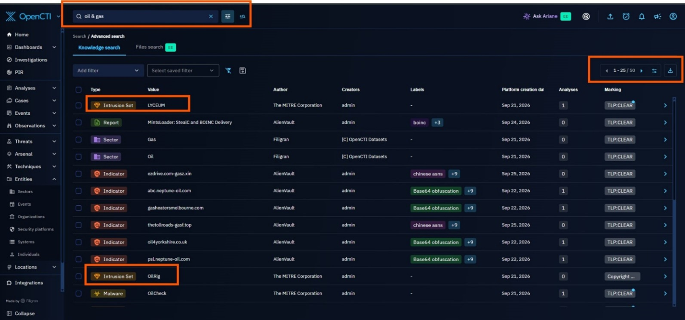
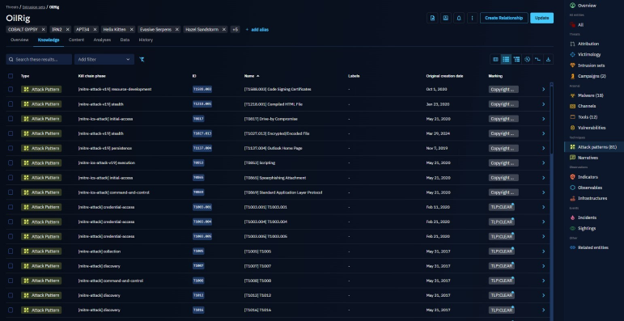
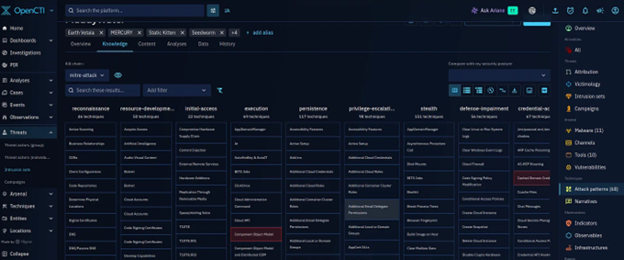
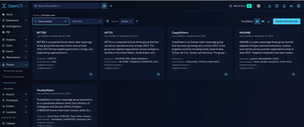
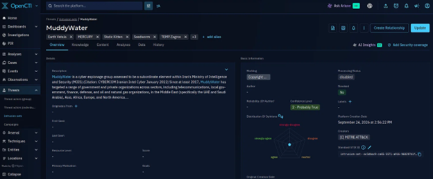
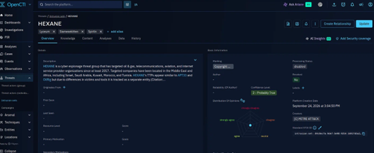
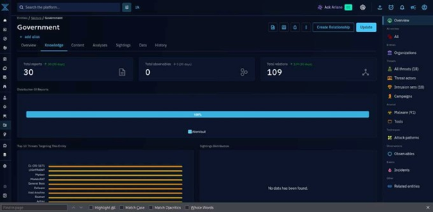
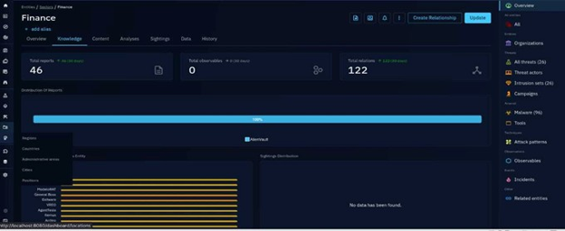
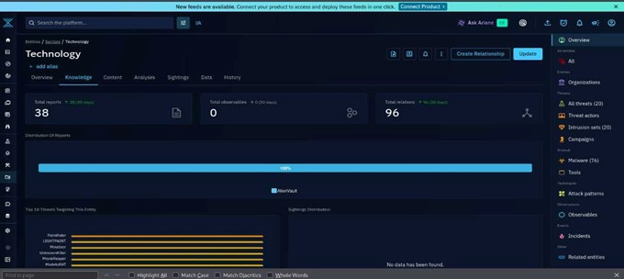
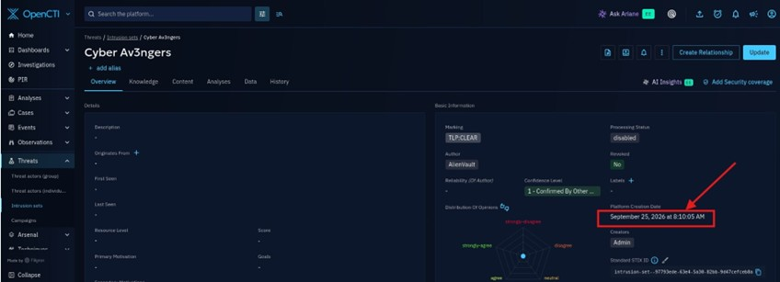

# Cyber Threat Intelligence Assessment - Desert Oil

## Overview

This Cyber Threat Intelligence Assessment evaluates the cyber threat landscape relevant to Desert Oil, a simulated oil and gas organization headquartered in Saudi Arabia. The assessment was conducted using OpenCTI as the primary threat intelligence platform, supported by AlienVault Open Threat Exchange (OTX), MITRE ATT&CK, CISA advisories, and other industry-recognized intelligence sources.

The objective of this assessment is to identify sector-specific threats, analyze threat actors and campaigns, evaluate national cyber risks, assess victim-targeting patterns, and provide actionable recommendations that support informed security and business decisions.

---

## Project Objectives

This assessment was conducted to achieve the following objectives:

- Analyze the threat landscape affecting the Oil and Gas/Energy sector.
- Evaluate the cyber threat environment in Saudi Arabia.
- Identify and map recently targeted victim sectors and associated threats.
- Investigate politically motivated threat actors with recent high-profile activity.
- Apply recognized threat intelligence frameworks including:
  - MITRE ATT&CK
  - Diamond Model of Intrusion Analysis
  - Cyber Kill Chain
- Develop recommendations to improve organizational resilience against identified threats.

---

## Scope

### Organization

**Desert Oil**  
Integrated oil and gas organization headquartered in Saudi Arabia.

### Intelligence Platform

- OpenCTI
- AlienVault OTX Connector

### Assessment Coverage

The assessment includes:

- Oil and Gas/Energy sector threat landscape
- Saudi Arabian national threat landscape
- Recently targeted victim sectors and associated threats
- Politically motivated threat actors targeting critical infrastructure
- Malware, campaigns, vulnerabilities, and adversary techniques relevant to operational and corporate environments

### Analytical Frameworks

- MITRE ATT&CK Framework
- Diamond Model
- Cyber Kill Chain

---

# Industry Sector Threat Landscape

Desert Oil was mapped to the **Oil and Gas/Energy** sector based on its activities in exploration, production, refining, and petrochemical distribution.

Analysis of OpenCTI intelligence, combined with regional threat activity and sector-specific targeting, identified the following threat actors as the most relevant to Desert Oil:

- OilRig
- MuddyWater
- Fox Kitten
- HEXANE

---

## Priority Threat Actors

### OilRig (APT34)

**Sector Relevance**

Targets:

- Energy
- Government
- Finance
- Chemical
- Telecommunications

**Primary Behaviors**

- Spear-phishing campaigns
- Fake VPN portals
- Fraudulent employment websites
- Credential theft
- Web shells
- Scheduled task persistence

**Associated Tools and Malware**

- Helminth
- QUADAGENT
- OopsIE
- OilBooster
- Mimikatz
- LaZagne

---

### MuddyWater

**Sector Relevance**

Targets:

- Government
- Defense
- Telecommunications
- Finance
- Oil and Gas

**Primary Behaviors**

- Malicious documents
- Password spraying
- Exploitation of public-facing systems
- PowerShell abuse
- Remote Desktop Protocol (RDP)

**Associated Tools and Malware**

- RustyWater
- SHARPSTATS
- PowGoop
- POWERSTATS
- Small Sieve
- Mimikatz
- LaZagne
- CrackMapExec
- Rclone

---

### Fox Kitten

**Sector Relevance**

Targets:

- Oil and Gas
- Telecommunications
- Aviation
- Government
- Information Technology

**Primary Behaviors**

- Exploitation of exposed VPN infrastructure
- Remote access product compromise
- Credential harvesting

**Associated Tools**

- POWSSHNET
- Juicy Potato
- SystemBC
- China Chopper

---

### HEXANE

**Sector Relevance**

Targets:

- Oil and Gas
- Telecommunications
- Aviation
- Internet Service Providers

**Primary Behaviors**

- Spear-phishing
- Compromised accounts
- DNS tunneling
- Scheduled tasks
- Registry-based persistence
- WMI subscriptions

**Associated Tools and Malware**

- Kevin
- DanBot
- DnsSystem
- Shark
- Milan
- PoshC2
- Mimikatz
- Empire
- BITSAdmin

---

## Common Malware and MITRE ATT&CK Techniques

### Initial Access

| Technique | ATT&CK ID | Associated Threat Actors |
|------------|------------|---------------------------|
| Spearphishing Attachment | T1566.001 | OilRig, MuddyWater, HEXANE |
| Spearphishing Link | T1566.002 | OilRig, MuddyWater, HEXANE |
| Exploit Public-Facing Application | T1190 | MuddyWater, Fox Kitten |
| Valid Accounts | T1078 | OilRig, MuddyWater, HEXANE |
| External Remote Services | T1133 | Fox Kitten |

### Execution

| Technique | ATT&CK ID |
|-----------|------------|
| PowerShell | T1059.001 |

### Persistence

| Technique | ATT&CK ID |
|-----------|------------|
| Scheduled Task/Job | T1053.005 |
| Registry Run Keys/Startup Folder | T1547.001 |
| Outlook Home Page | T1137.004 |
| Web Shell | T1505.003 |

### Credential Access

| Technique | ATT&CK ID |
|-----------|------------|
| OS Credential Dumping | T1003 |
| Password Spraying | T1110.003 |

### Command and Control

| Technique | ATT&CK ID |
|-----------|------------|
| Web Protocols | T1071.001 |
| DNS | T1071.004 |

### Exfiltration

| Technique | ATT&CK ID |
|-----------|------------|
| Exfiltration to Cloud Storage | T1567.002 |

---

## Targeting Patterns

Analysis revealed three recurring attack patterns:

### Phishing and Social Engineering

- Malicious attachments
- Malicious links
- Fake VPN portals
- Fraudulent job offers
- Employment-themed phishing

### Exploitation of Exposed Infrastructure

- Public-facing applications
- VPN appliances
- Internet-accessible services
- Remote access platforms

### Credential-Based Attacks

- Password spraying
- Credential harvesting
- Compromised email accounts
- Abuse of valid credentials

### Common Post-Compromise Activity

- PowerShell execution
- Credential dumping
- Remote Desktop access
- Scheduled tasks
- Registry modifications
- DNS tunneling
- Web shell deployment

---

## Associated Vulnerabilities

| CVE | Product | CVSS | Associated Actor | Relevance |
|------|----------|-------|------------------|------------|
| CVE-2017-11882 | Microsoft Office Equation Editor | 7.8 | OilRig | Code execution via malicious documents |
| CVE-2024-30088 | Microsoft Windows Kernel | 7.0 | OilRig | Local privilege escalation |
| CVE-2019-11510 | Pulse Secure Connect | 10.0 | Fox Kitten | Unauthorized access to VPN systems |
| CVE-2018-13379 | Fortinet FortiOS SSL VPN | 9.8 | Fox Kitten | Exposure of sensitive files |
| CVE-2019-1579 | Palo Alto GlobalProtect | 9.8 | Fox Kitten | Remote code execution |
| CVE-2019-19781 | Citrix ADC / NetScaler Gateway | 9.8 | Fox Kitten | Directory traversal and code execution |

---

## Historical Industry Incidents

| Date | Incident | Significance |
|--------|------------|-------------|
| August 2012 | Shamoon | Destructive malware impacted 30,000+ Saudi Aramco systems |
| 2016-2017 | Shamoon 2.0 | Follow-on destructive campaign in Saudi Arabia |
| December 2018 | Saipem Incident | Shamoon-linked attack affecting an oil and gas contractor |
| December 2019 | ZeroCleare | Destructive malware targeting energy organizations |
| 2024 | CISA/FBI/DC3 Advisory AA24-241A | Fox Kitten exploitation of remote-access infrastructure |

---

# National Threat Landscape (Saudi Arabia)

OpenCTI intelligence identified several threat groups associated with Saudi Arabia. Based on activity level, sector relevance, and documented operations, the two most significant threats are:

- MuddyWater
- HEXANE

---

## Threat 1: MuddyWater

### Overview

MuddyWater targets:

- Government
- Telecommunications
- Finance
- Defense
- Oil and Gas

### Tactics

- Spearphishing
- Password spraying
- Public-facing application exploitation
- Remote Desktop abuse
- Credential theft

### Associated Tools

- RustyWater
- SHARPSTATS
- PowGoop
- POWERSTATS
- Small Sieve
- Mori
- Fooder
- Koadic
- Empire
- CrackMapExec
- Rclone

### Associated Campaigns

- Outer Space
- Juicy Mix

### Notable ATT&CK Techniques

- T1566.001 – Spearphishing Attachment
- T1190 – Exploit Public-Facing Application
- T1110.003 – Password Spraying
- T1059.001 – PowerShell
- T1021.001 – Remote Desktop Protocol
- T1003 – Credential Dumping
- T1567.002 – Exfiltration to Cloud Storage

---

## Threat 2: HEXANE

### Overview

HEXANE targets:

- Oil and Gas
- Telecommunications
- Aviation
- Internet Service Providers

### Tactics

- Spearphishing
- Credential harvesting
- Registry persistence
- Scheduled tasks
- WMI subscriptions

### Associated Tools

- Kevin
- DanBot
- DnsSystem
- Shark
- Milan
- PoshC2
- Empire
- Mimikatz
- BITSAdmin

### Notable ATT&CK Techniques

- T1566 – Phishing
- T1078 – Valid Accounts
- T1547.001 – Registry Run Keys
- T1053.005 – Scheduled Tasks
- T1546.003 – WMI Event Subscriptions
- T1003 – Credential Dumping
- T1567.002 – Exfiltration to Cloud Storage

---

# Victim Profile and Threat Mapping

Analysis of OpenCTI intelligence identified the following sectors as the most actively targeted:

1. Government
2. Finance
3. Technology

---

## Government Sector

### Lead Threat: CL-CRI-1171

A long-running cybercrime campaign that leveraged a pay-per-install ecosystem to distribute multiple malware families and target organizations globally.

### Primary Malware

- OfferLoader
- Insomnia RAT
- ARKTunnel
- Docro Hijacker

### Diamond Model

#### Adversary

Unknown

#### Capability

- Malware delivery
- Phishing
- Cookie theft
- Browser compromise
- Process modification

#### Infrastructure

Unknown

#### Victim

- Government
- Energy

### Kill Chain Highlights

**Initial Access**

- Drive-by Compromise (T1189)
- Phishing (T1566)

**Execution**

- PowerShell (T1059.001)
- JavaScript (T1059.007)
- Python (T1059.006)

**Persistence**

- Windows Services (T1543.003)
- Registry Run Keys (T1547.001)

**Credential Access**

- Session Hijacking (T1185)
- Cookie Theft (T1539)

---

## Finance Sector

### Lead Threat: Cerberus

Cerberus is a banking trojan offered through malware-as-a-service models and widely used against financial institutions.

### Diamond Model

#### Adversary

DukeEugene

#### Capability

- Credential theft
- GUI input capture
- SMS interception
- Remote control
- Web portal capture

#### Infrastructure

Unknown

#### Victim

Finance Sector

### Kill Chain Highlights

**Defense Evasion**

- T1406
- T1407
- T1516

**Discovery**

- T1418
- T1426

**Collection**

- T1056.002
- T1056.003
- T1114
- T1417

**Command and Control**

- T1437.001
- T1509

**Impact**

- T1582 (SMS Control)

---

## Technology Sector

### Lead Threat: PolinRider

PolinRider is associated with credential theft, supply-chain compromise, cloud abuse, and browser credential extraction.

### Diamond Model

#### Adversary

Unknown

#### Capability

- Supply-chain compromise
- DLL search-order hijacking
- Browser credential theft
- Token theft
- Cloud-based exfiltration

#### Infrastructure

- Dead Drop Resolvers
- Web Protocols

#### Victim

Technology Sector

### Kill Chain Highlights

**Initial Access**

- Valid Accounts (T1078)
- Software Supply Chain Compromise (T1195)

**Execution**

- JavaScript (T1059.007)
- DLL Side-Loading (T1574.001)

**Persistence**

- Account Manipulation (T1098)
- Cloud Account Creation (T1136.003)

**Credential Access**

- Application Token Theft (T1528)
- Session Cookie Theft (T1539)
- Browser Credential Theft (T1555.003)

**Exfiltration**

- Exfiltration to Cloud Storage (T1567.002)

---

# Politically Motivated Threat Group

## CyberAv3ngers

CyberAv3ngers is an Iranian state-linked threat group known for targeting operational technology and industrial control systems supporting critical infrastructure.

### Motivation

- Political and ideological objectives
- Support of Iranian strategic interests
- Disruption of critical infrastructure

### Typical Targets

- Oil and Gas
- Energy
- Water Utilities
- Fuel Systems
- Industrial Control Systems (ICS)

### Known Methods

- Internet scanning
- Exploitation of exposed devices
- Abuse of default credentials
- Industrial control system disruption

### Significant Activity

- Compromise of Unitronics PLCs
- Aliquippa water utility incident
- IOCONTROL malware development
- Attacks against fuel-management infrastructure

### Organizational Relevance

Although Desert Oil has not been directly targeted, CyberAv3ngers targets the same OT environments used throughout modern energy operations. Their activity demonstrates the risks posed by exposed industrial devices, weak passwords, and inadequate network segmentation.

---

# Key Findings

1. Desert Oil operates within a high-risk threat environment influenced by OilRig, MuddyWater, Fox Kitten, and HEXANE.

2. The most common attack vectors remain:
   - Phishing
   - Credential theft
   - Exploitation of public-facing applications
   - VPN compromise

3. Supply-chain and third-party relationships represent significant exposure paths.

4. Operational Technology (OT) systems remain a primary target for politically motivated threat actors.

5. Historical incidents such as Shamoon and ZeroCleare demonstrate the destructive potential of attacks against the energy sector.

---

# Business Impact Analysis

The identified threats may result in:

### Operational Disruption

Compromise of industrial systems may interrupt production and require manual operations.

### Business System Downtime

Destructive malware can significantly affect critical business services.

### Unauthorized Access

Compromised credentials can provide attackers access to internal and cloud environments.

### Information Loss

Espionage operations may expose sensitive business and operational data.

### Third-Party Risk

Compromised vendors and trusted partners may become attack pathways.

---

# Recommendations

## Strengthen Identity Security

- Enforce MFA across all services.
- Protect privileged and third-party accounts.

## Secure Internet-Facing Assets

- Maintain asset inventories.
- Remediate vulnerabilities promptly.
- Harden VPN and remote-access infrastructure.

## Protect Operational Technology

- Remove direct internet exposure.
- Replace default credentials.
- Implement IT/OT network segmentation.

## Improve Threat Monitoring

Monitor for:

- Phishing activity
- Credential theft
- PowerShell abuse
- Remote Desktop activity
- Web shells
- Scheduled-task persistence

## Manage Third-Party Access

- Restrict supplier access.
- Review permissions regularly.
- Enforce MFA requirements.

## Strengthen Recovery Capabilities

- Maintain offline and immutable backups.
- Conduct recovery testing exercises.

## Enhance Incident Response

- Develop OT-specific response procedures.
- Regularly test crisis and recovery plans.

---

# Conclusion

Desert Oil operates within an increasingly complex threat landscape characterized by cyber espionage, credential theft, destructive malware, supply-chain compromise, exploitation of exposed infrastructure, and politically motivated attacks targeting operational technology.

Threat actors such as OilRig, MuddyWater, Fox Kitten, HEXANE, and CyberAv3ngers demonstrate the diverse range of risks facing modern energy organizations. Historical incidents within the sector further reinforce the potential consequences of inadequate security controls, including operational disruption, data loss, business downtime, and prolonged recovery efforts.

To reduce these risks, Desert Oil should prioritize identity security, vulnerability management, network segmentation, secure remote access, continuous monitoring, incident response readiness, and operational resilience across both IT and OT environments.

The findings of this assessment provide a threat-informed foundation for strengthening cybersecurity governance and improving the organization's overall security posture.
